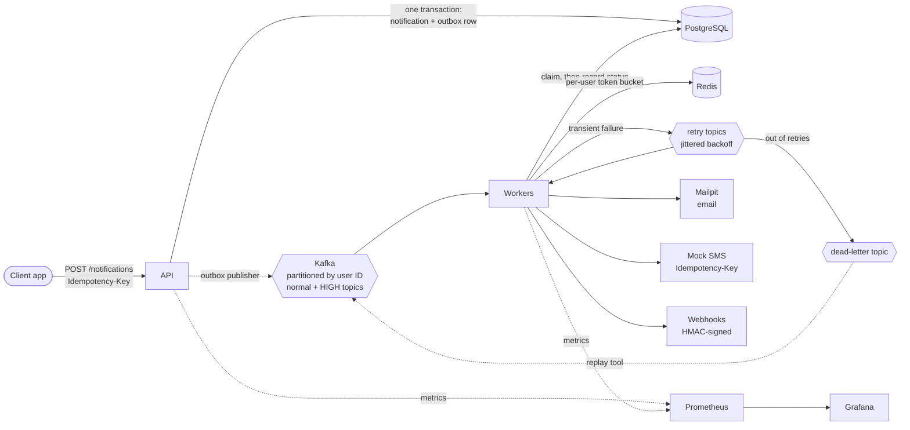

# Event-Driven Notification Service

A multi-channel notification service. Other applications ask it to notify a user; it picks
the channel, respects user preferences and rate limits, and delivers every notification
exactly once from the user's point of view, even when workers, the broker, or providers fail.

It runs on one laptop at **about 430 notifications a second** with zero lost or duplicated
across 1.16 million load-tested notifications, and **loses nothing** while workers, Kafka and the
API are killed under load. See [docs/RESULTS.md](docs/RESULTS.md) for the measurements and
[docs/DESIGN.md](docs/DESIGN.md) for how it gets there.

| | Result |
|---|---|
| Sustained throughput (single laptop, bound by the disk's WAL flush rate) | about 430 a second |
| End-to-end latency at 200 a second, p50 / p95 / p99 | 156 ms / 244 ms / 1.1 s |
| Lost or duplicated in 31 load-test runs (1,157,379 notifications) | 0 |
| Chaos run: 2 workers and the API killed, Kafka restarted, 200 ms network latency | 0 lost, 2 duplicate emails* |

\* A worker killed between the SMTP send and recording it; SMTP has no idempotency key. SMS has
no such window: the provider accepts each notification ID once.

## Architecture



The API writes each notification and an outbox row in one transaction, so a notification is
published if and only if it was stored. Kafka delivers at least once; a worker claims a
notification in Postgres before sending it, so a redelivered or rebalanced message is never sent
twice. User preferences, quiet hours and per-user rate limits are applied at delivery time.

## Stack

Java 21 · Spring Boot 4.1 · Kafka 4.3 (KRaft) · PostgreSQL 16 · Redis 7 · Docker Compose ·
Prometheus · Grafana · JUnit 5 · Testcontainers · k6 · Toxiproxy

## Modules

| Module | Port | Purpose |
|---|---|---|
| `api` | 8080 | Accepts notifications, writes them and an outbox row in one transaction |
| `worker` | 8081 | Kafka consumers that claim, deliver and retry; also the dead-letter replay tool |
| `mock-sms` | 8082 | Fake SMS provider that injects timeouts, errors and slow responses |
| `chaos-test` | — | Kills workers and the API mid-run; checks nothing is lost or sent twice |
| `loadtest` | — | k6 load test, the delivery verifier and the chaos run |
| `infra` | — | Docker Compose stack, Prometheus, Grafana and Toxiproxy config |

## Quick start

Prerequisites: Docker. One command builds the services and starts everything, creating
`infra/.env` with random passwords on the first run:

```bash
bash scripts/quickstart.sh          # stop with: bash scripts/quickstart.sh down
```

Then open the Grafana dashboard at http://localhost:3000 and the Mailpit inbox at
http://localhost:8025, and send a notification (below).

## Development setup

Prerequisites: Java 21 and Docker. Run the infrastructure in Docker and the services with Maven:

```bash
# 1. Configure local secrets (once); or run scripts/quickstart.sh once, which writes it
cp infra/.env.example infra/.env        # then set the passwords and the webhook secret

# 2. Start infrastructure: Kafka, Postgres, Redis, Mailpit
docker compose -f infra/docker-compose.yml up -d

# Optional: also start Prometheus, Grafana and the Kafka lag exporter
docker compose -f infra/docker-compose.yml --profile observability up -d

# 3. Build and test everything
./mvnw verify

# 4. Run a service (one terminal each)
./mvnw -pl api spring-boot:run
./mvnw -pl worker spring-boot:run
./mvnw -pl mock-sms spring-boot:run
```

On Windows PowerShell, use `.\mvnw.cmd` instead of `./mvnw`.

Python is only used for the load-test verifier:

```bash
python -m venv .venv                      # once
source .venv/bin/activate                 # Linux, macOS, WSL
source .venv/Scripts/activate             # Git Bash on Windows
.venv\Scripts\Activate.ps1                # PowerShell
pip install -r requirements.txt
```

## Try it

```bash
curl -i -X POST http://localhost:8080/notifications   -H "Content-Type: application/json"   -d '{"userId":"user-42","channel":"EMAIL","recipient":"alice@example.com","subject":"Your order shipped","body":"It arrives Friday."}'
# 202 Accepted, Location: /notifications/{id}, status QUEUED

curl http://localhost:8080/notifications/{id}
# status becomes SENT within a second; the email shows up at http://localhost:8025
```

SMS works the same way, with an E.164 phone number and no subject. Run `mock-sms` too; it fails,
times out or answers slowly on purpose, and the worker retries until it gets through:

```bash
curl -i -X POST http://localhost:8080/notifications -H "Content-Type: application/json" \
  -d '{"userId":"user-42","channel":"SMS","recipient":"+6591234567","body":"Your code is 123456"}'
curl http://localhost:8082/v1/messages/stats    # what the fake provider received
```

Invalid requests return `400` with an RFC 9457 problem body listing each invalid field.

Retries are safe with an `Idempotency-Key` header (scoped per `userId`). Repeating the request
returns the same notification with `Idempotent-Replayed: true`; reusing the key with a different
body returns `422`.

```bash
curl -i -X POST http://localhost:8080/notifications -H "Content-Type: application/json"   -H "Idempotency-Key: order-42-shipped"   -d '{"userId":"user-42","channel":"EMAIL","recipient":"alice@example.com","subject":"Your order shipped","body":"It arrives Friday."}'
```

## Webhooks

`"channel":"WEBHOOK"` POSTs the notification to the recipient URL, signed the way the
[Standard Webhooks](https://www.standardwebhooks.com) spec describes, so receivers can verify it
with any Standard Webhooks library. Every request carries `webhook-id` (the notification ID, the
same on every retry, so receivers can drop repeats), `webhook-timestamp` and
`webhook-signature: v1,<base64 HMAC-SHA256 of id.timestamp.body>`. The subject becomes the event
`type`.

```bash
curl -i -X POST http://localhost:8080/notifications -H "Content-Type: application/json" \
  -d '{"userId":"user-42","channel":"WEBHOOK","recipient":"https://example.com/hooks","subject":"order.shipped","body":"{\"orderId\":42}"}'
```

The signing secret is `WEBHOOK_SIGNING_SECRET` in `infra/.env`. Webhook URLs must be https and
resolve to public addresses; to test against a receiver on your machine, start the worker with
`WEBHOOK_ALLOW_PRIVATE_TARGETS=true` and use `http://localhost:<port>/...`.

## User preferences

Users can turn channels off and set quiet hours in their own time zone. Preferences are checked
when a notification is delivered, so a change also applies to notifications already queued.
A notification on a disabled channel ends as `SUPPRESSED`; one that arrives during quiet hours
becomes `DEFERRED` with a `deliverAfter` time, and is sent when the quiet hours end.

```bash
curl -X PUT http://localhost:8080/users/user-42/preferences -H "Content-Type: application/json" \
  -d '{"allowedChannels":["EMAIL"],"quietHours":{"start":"22:00","end":"07:00","timeZone":"Asia/Singapore"}}'
curl http://localhost:8080/users/user-42/preferences   # every channel, no quiet hours, if never set
```

## Priority

Set `"priority":"HIGH"` for notifications the user is waiting for, such as password resets
and login codes. They go to their own topics (`notifications.sms.high`, `notifications.email.high`)
with their own consumers, so they never wait behind a marketing backlog. They also ignore quiet
hours and have a separate, smaller rate limit, but still respect a channel the user turned off.

```bash
curl -i -X POST http://localhost:8080/notifications -H "Content-Type: application/json" \
  -d '{"userId":"user-42","channel":"SMS","recipient":"+6591234567","body":"Reset code 123456","priority":"HIGH"}'
```

## Rate limits

Each user has a token bucket per channel in Redis: by default a burst of 5 SMS, then 5 a
minute, and a burst of 20 emails, then 20 a minute. A notification over the limit is not
dropped: it reserves the next free slot and becomes `DEFERRED` until then. Only one that would
wait more than an hour is `SUPPRESSED` with `RATE_LIMITED`. Limits are set under
`notifications.rate-limit` in `worker/src/main/resources/application.yml`.

## Failures, retries and replay

A send that fails for a reason a retry may fix moves through `<topic>-retry-0` … `-retry-4`
with growing, jittered delays (about 2s, 6s, 18s, 54s, 60s). After the last retry it lands in
`<topic>-dlt` and the notification is marked `FAILED` with `RETRIES_EXHAUSTED`. Change the fake
provider's fault rates at runtime to see it:

```bash
curl -X PUT http://localhost:8082/admin/faults -H "Content-Type: application/json" \
  -d '{"failureRate":1,"timeoutRate":0,"slowRate":0,"timeoutDelay":"PT10S","slowDelay":"PT1S"}'
```

Once the cause is fixed, replay the dead letters. The tool requeues each notification, sends
it through the main topic again, and exits:

```bash
./mvnw -pl worker spring-boot:run -Dspring-boot.run.profiles=replay \
  -Dspring-boot.run.arguments=--topic=notifications.sms-dlt
```

## Observability

Start Prometheus, Grafana and the Kafka lag exporter with the `observability` profile (see Quick
start), run the services, then open the **Notification service** dashboard in Grafana
(http://localhost:3000, folder *Notification service*). It refreshes every 5 seconds and shows:

| Row | What it answers |
|---|---|
| Overview | Accepted and sent per second, p99 end-to-end latency, share sent within 200 ms, consumer lag, dead letters |
| Throughput | Accepted by channel and priority, every delivery outcome, sent by channel |
| Latency | End-to-end p50/p95/p99, provider send time per channel, API response time |
| Backlog | Consumer lag per group (from the broker, so it still rises when every worker is down), outbox, deferred |
| Retries and errors | Retries, dead letters, failed and suppressed, error log lines, API 5xx, rate-limiter decisions |
| Services | Which services Prometheus can scrape, JVM heap |

The dashboard is provisioned from `infra/grafana/dashboards/notification-service.json`; edit
that file, since changes made in the Grafana UI are not saved.

The service's own metrics, all on `/actuator/prometheus`:

| Metric | Labels | From |
|---|---|---|
| `notification_requests_total` | channel, priority, result (`created`, `replayed`) | api |
| `notification_outbox_published_total`, `notification_outbox_publish_failures_total` | | api |
| `notification_outbox_backlog`, `notification_outbox_oldest_age_seconds`, `notification_deferred_backlog` | | api |
| `notification_deliveries_total` | channel, priority, outcome (`sent`, `failed`, `suppressed`, `deferred`, `skipped_*`, `retry`, `error`) | worker |
| `notification_delivery_latency_seconds` (histogram) | channel, priority | worker |
| `notification_send_seconds` (histogram) | channel, result | worker |
| `notification_dead_letters_total` | topic | worker |
| `notification_rate_limit_decisions_total` | channel, priority, decision (`now`, `later`, `rejected`, `unavailable`) | worker |

**Logs** are JSON, one object per line in the Elastic Common Schema. Every line logged while a
notification is handled carries its `notificationId`, including Spring Kafka's own lines about
retries, so one ID finds the whole story:

```bash
grep '"notificationId":"<id>"' worker.log | jq -r '[."@timestamp", .log.level, .message] | @tsv'
```

For readable text in a terminal, set `LOG_FORMAT` to an empty value:
`LOG_FORMAT= ./mvnw -pl worker spring-boot:run`.

## Tests

```bash
./mvnw verify            # unit and integration tests (Testcontainers; needs Docker)
./mvnw -Pchaos verify    # also the chaos test: about 3 minutes, report in chaos-test/target/chaos-report.md
```

End-to-end smoke test, with infrastructure, `api` and `worker` running:

```bash
bash scripts/smoke-test.sh
```

## Load and chaos tests

```bash
RATE=400 DURATION=90s bash loadtest/run.sh      # load test, then verify every delivery
RATE=300 DURATION=150s bash loadtest/chaos.sh   # the same while things are killed and slowed
```

`run.sh` needs the services and the observability profile running; `chaos.sh` starts its own
services behind Toxiproxy (`--profile chaos`). Both end with a table of throughput, latency,
consumer lag, and lost and duplicated counts. See [loadtest/README.md](loadtest/README.md) and
the results in [docs/RESULTS.md](docs/RESULTS.md).

## Local URLs

| What | URL |
|---|---|
| API health | http://localhost:8080/actuator/health |
| Mailpit inbox | http://localhost:8025 |
| Mock SMS stats | http://localhost:8082/v1/messages/stats |
| Prometheus | http://localhost:9090 |
| Grafana | http://localhost:3000 (dashboard: *Notification service*) |
| API metrics | http://localhost:8080/actuator/prometheus |

## Stopping

```bash
docker compose -f infra/docker-compose.yml --profile observability down       # keep data
docker compose -f infra/docker-compose.yml --profile observability down -v    # wipe data
```
